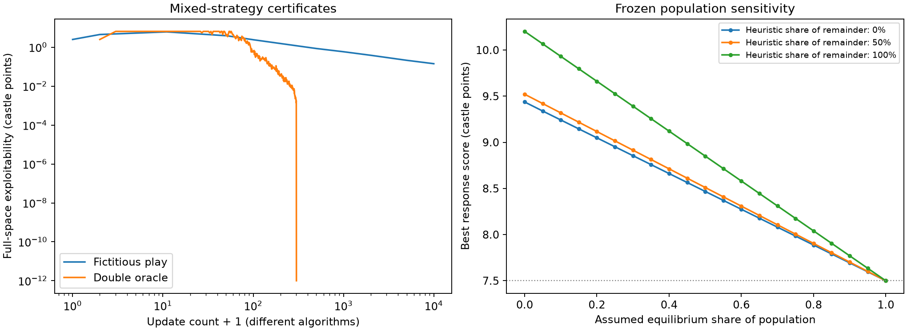

# Game 1：逐层反制、混合均衡与对手建模

本项目研究100名士兵分配到价值为1、2、3、4、5的五座城堡。每个配兵是非负整数向量，总和恰好为100。目标是面对全体其他申请者的**平均城堡分数**，满分15；不是赢得对局的比例。这里只研究 Game 1。[官方页面](https://pokerbot.sequoiacap.com/)与本地 [Rules.md](rules.md) 的相关计分规则一致，核验日期为2026年11月3日。

最新进展见 [中英双语队友报告](team_update.md)：降低 H 比例，改进 C，加入有限推理 S，重新搜索得到 `(8,9,10,11,62)`。本文保留此前八场景实验的推导和历史结果。

提交时只能填写一个固定向量。代码里的迭代都是提交前的离线推演。下面先判断原推理，再解释已实现的算法、实验结果及下一步最有价值的工作。

## 1. 先判断原来的几个结论

“固定其他参赛者的策略后，可以用 DP 高效求最佳回应”是正确的。如果其他人各提交一个向量，就把他们视为一个等权经验分布；如果尚不知道他们提交什么，就输入一个假设分布。DP 会精确优化这个输入分布，但不会检验假设是否真实。

“完全随机的对手，应以 `(0,0,0,0,100)` 应对”在两种自然定义下都不成立：

| “随机”的明确定义 | 最佳回应，按1至5分城排列 | 最优期望分 | 全押第五城的期望分 |
| --- | --- | --- | --- |
| 所有合法整数配兵等概率 | `(0,12,23,30,35)` | 9.884909 | 5.192307 |
| 每个士兵独立、等概率选择一城 | `(0,23,25,26,26)` | 12.576716 | 5.000000 |

第一种随机模型有

\[
N=\binom{104}{4}=4{,}598{,}126
\]

个合法向量。固定某城为 \(t\) 人后，剩下四城分配 \(100-t\) 人，共有 \(\binom{103-t}{3}\) 种，所以

\[
P(Y_i=t)=\frac{\binom{103-t}{3}}{\binom{104}{4}}.
\]

第二种模型的单城人数服从 \(\operatorname{Binomial}(100,1/5)\)，人数集中在20附近。因此在高分城略高于20即可获得较高胜率。两种模型里的各城人数都受总预算约束，并不相互独立。

你的下一步“用 `(1,1,1,1,96)` 反制全押第五城”则是正确的。它拿下前四城共10分，是最佳回应之一。对全押第五城不可能赢第五城；若想在那里打平就必须用完100人，反而只有7.5分，因此10分确实最优。但再机械地变成 `(2,2,2,2,92)` 就不再是最佳回应：它仍得10分，而 `(0,0,1,2,97)` 对 `(1,1,1,1,96)` 得

\[
0+0+\frac32+4+5=10.5.
\]

你的补充材料中，计分目标、边际收益、DP 递推和“情景比例不能当事实”的判断都成立。三个策略之间相互克制的例子也成立。不过，“存在一个克制环”只能说明循环可能发生；要判断本题会不会收敛，需要更强的论证。

## 2. 本题没有纯策略均衡：一个完整证明

令 \(u(x,y)\) 表示配兵 \(x\) 对 \(y\) 得到的城堡分。由于每座城的全部分值都由双方分掉，

\[
u(x,y)+u(y,x)=15,\qquad u(x,x)=7.5.
\]

任取一个固定配兵 \(x\)。选兵数最多的城 \(j\)，则 \(x_j\ge20\)。从该城撤出4人，给其余四城各加1人，得到 \(y\)：

\[
y_j=x_j-4,\qquad y_i=x_i+1\quad(i\ne j).
\]

新配兵仍是非负整数且总和为100。它输掉第 \(j\) 城、赢得另外四城，因此

\[
u(y,x)=15-j\ge10>7.5.
\]

所以**每个纯策略都有一个能对它拿到至少10分的反制**。若存在纯策略 Nash equilibrium \((x,z)\)，双方都必须是对另一方的最佳回应，于是双方得分都至少10，与总分恒为15矛盾。故不存在任何纯策略 Nash equilibrium。

这还给出一个有用的区别：如果坚持提交确定的纯策略，并让对手知道后专门针对它，纯策略的最优保底分恰好是5。上面的构造证明任何纯策略都无法保证超过5；而 `(0,0,0,0,100)` 对任何其他合法配兵都至少拿5分，对完全相同的配兵拿7.5分。因此你的 all-in 方案确实解决了这个**纯策略 maximin** 问题，只是不解决“随机人群下最大化平均分”的问题。

再固定一个并列最优解的选取规则，使 \(T(x)=\operatorname{BR}(x)\) 成为确定函数。合法配兵只有有限个，因此反复应用 \(T\) 最终必然重复某个状态，随后进入循环。又因为 \(u(T(x),x)\ge10>u(x,x)\)，所以 \(T(x)\ne x\)，不存在长度为1的循环。也不可能是两状态循环：两边若互为最佳回应，双方得分都会至少10。

当前 DP 的并列规则是：在当前城堡上选择人数最少的计算最优项，再回溯前面的城堡。本次从全押第五城出发，经过34个过渡状态，进入99个状态的循环。从另外三个起点也观察到长度99的循环。**99是这个实现和这些起点的实验结果，不是所有 tie-breaking 的定理。**

## 3. DP 究竟优化了什么

令 \(p_i(t)=P(Y_i=t)\)。我们在第 \(i\) 城放 \(a\) 人，收益为

\[
g_i(a)=i\left[\sum_{t=0}^{a-1}p_i(t)+\frac12p_i(a)\right].
\]

把人数从 \(a\) 增至 \(a+1\) 的收益变化是

\[
g_i(a+1)-g_i(a)=\frac{i}{2}\big[p_i(a)+p_i(a+1)\big].
\]

这里的两项分别来自“原来平局，现在获胜”和“原来失败，现在平局”。这解释了为什么靠近对手概率峰的兵力门槛重要。但收益变化不一定递减，所以逐个贪心分配士兵不一定最优。

定义 \(D(j,b)\) 为前 \(j\) 座城恰好用 \(b\) 人的最高期望收益，初值 \(D(0,0)=0\)，其他 \(D(0,b)=-\infty\)。枚举最后一座城放 \(a\) 人，就得到

\[
D(j,b)=\max_{0\le a\le b}\{D(j-1,b-a)+g_j(a)\}.
\]

每个合法方案都会进入某一项，而每一项的前缀已经最优，故递推不会漏掉全局最优解。最后从记录的最大项回溯出五个整数。时间为 \(O(KB^2)\)，本题 \(K=5,B=100\)。完整的小数字例子、矩阵维度和代码映射见 [game.md](modules/game.md)。

**边际分布足够计算收益，不代表可以任意拼接五个边际分布作为合法策略。** 构造混合均衡时还必须保证各城人数能联合起来、每次恰好合计100。代码始终从合法完整向量构造分布，避免丢失这个预算条件。

## 4. 能收敛的是哪种对象

Mixed strategy 是合法配兵上的概率分布。例如，以各一半概率提交 `(0,0,0,50,50)` 或 `(0,0,50,25,25)`，与提交它们的均值 `(0,0,25,37.5,37.5)` 是不同决策；均值甚至不是合法整数向量。即使取整，也不能保留原来的赢城概率。

本题策略集合有限，因此存在混合均衡。[Nash 的有限博弈存在定理](https://www.pnas.org/doi/10.1073/pnas.36.1.48)适用。由于本题双方策略集合相同且恒和15，minimax 值为7.5：若一方能保证严格超过7.5，另一方用同样的保障策略也应严格超过7.5，与恒和矛盾；若值严格小于7.5，交换双方也产生矛盾。

这个结论没有说均衡唯一，也没有说任意更新方法都会收敛。代码实现了两种不同方法。

**Fictitious play** 每轮针对全部历史策略的经验分布求最佳回应，再把新回应加入历史。有限双人零和情形的定理保证经验分布趋近均衡集合，并不保证当前纯策略或某一个指定分布收敛，有限轮误差也未必单调下降。[Robinson (1951) 原文](https://cs.brown.edu/courses/csci1440/labs/2023/lab01/robinson.pdf)。本次10,000轮后，可利用误差仍为0.142186分。

**Double oracle** 用来更快求解并检查结果：先选少量合法策略，解它们之间的零和 LP；再用 DP 在全部合法配兵中寻找最强反制。如果仍能显著提高收益，就把该反制加入集合并重新求解。这是数值求解算法，不是关于人类推理过程的心理模型。

对输出分布 \(q\)，用 DP 测量

\[
\epsilon(q)=\max_x u(x,q)-7.5.
\]

恒和立即给出

\[
\min_yu(q,y)=15-\max_yu(y,q)=7.5-\epsilon(q).
\]

这是检查**完整策略空间**的证书。本次300轮 LP 后得到199个正权重配兵，\(\epsilon\approx4.62\times10^{-14}\)，已处于浮点误差范围；不是使用精确有理数证明了误差为零。完整配兵及概率保存在 [equilibrium.json](../results/equilibrium.json)。

如果选择保守的混合方案，可以按这些概率抽取一个完整向量，然后只提交一次。保证针对抽签前的期望成立，抽出的单个向量仍然能被反制。以下代码展示抽样方式，项目没有替你提交任何向量：

```python
import json
import numpy as np

with open("results/equilibrium.json") as file:
    equilibrium = json.load(file)
rng = np.random.default_rng()
index = rng.choice(len(equilibrium["weights"]), p=equilibrium["weights"])
allocation_to_submit = equilibrium["allocations"][index]
```

## 5. 对“聪明大学生”的判断，应转成哪些假设

“只有很小比例凭直觉，大多数会集中投入或使用均衡”目前是**未确定的人群假设**。集中程度是配兵形状；是否使用均衡是一个决策规则，两者不能直接对应聪明程度。认真分析的人也可能采用不同的初始分布、有限推理层数、整数偏好，或不同的目标理解。

与本题有关的大学生及读者 Blotto 实验观察到了多种推理维度和策略差异，并未支持把一次性参与者直接视为共同使用 Nash 策略。但那篇研究使用120兵、六座等值城、平局不计分，不能将其人群比例或最优向量移植到本题。[Arad & Rubinstein (2012)](https://www.tau.ac.il/~aradayal/blotto.pdf)

从这个角度看，假定很多容易利用的直觉玩家，会让预计得分更乐观。“大部分人接近均衡”反而是对可利用机会较保守的假设。提高假定的聪明玩家比例是值得做的压力测试，但缺少本场数据时不应把它当作已经证实的结论。

还有一个比比例更关键的区别：**聪明玩家是否针对同一个市场共同调整。** 固定混合

\[
Q=0.25H+0.25C+0.50E
\]

中的 \(E\) 是原游戏的均衡，未必是面对含直觉型 \(H\)、集中型 \(C\) 人群时的最佳策略。若其他聪明人也看到了这些可利用机会，他们会重新分配。

因此，项目另设背景人群 \(Q_0\) 占比 \(\rho\)，聪明人群分布 \(S\) 必须适应

\[
Q=\rho Q_0+(1-\rho)S.
\]

这里的条件是：\(S\) 使用的策略应当都是对整个 \(Q\) 的最佳回应。代码通过一个保持 best response 不变的零和转换求解，具体推导见 [dynamics.md](modules/dynamics.md)。这同时考虑“我反制直觉者”和“别人也反制直觉者”。它是大人群分布模型，没有单独模拟有限参赛人数导致的自我排除修正。

## 6. 本次实验得到了什么

行为模型的完整生成规则见 [opponents.md](modules/opponents.md)，八种情景的比例见 [run_experiments.md](experiments/run_experiments.md)。所有结果都是这些假设下的计算。用户补充的旧表缺少完整生成器和参数，不能声称这里复现了旧数值。

| 固定配兵 | 25%直觉+25%集中+50%原博弈均衡 | 10%直觉+70%集中+20%原博弈均衡 | 25%直觉+75%共同适应者 |
| --- | --- | --- | --- |
| 旧基准 `(1,1,21,31,46)` | 8.284062 | 8.263475 | 7.654613 |
| 旧集中 `(1,1,1,41,56)` | 8.475406 | 9.001962 | 7.654613 |
| 旧折中 `(1,14,1,37,47)` | 8.304781 | 8.504487 | 7.654613 |
| 新基准最佳回应 `(8,2,2,36,52)` | 8.510594 | 8.756237 | 7.654369 |
| 新 minimax regret `(1,2,2,40,55)` | 8.503219 | 8.941237 | 7.654613 |

各列都是期望城堡分。最后一列里多个结构不同的策略几乎同分，是所求适应均衡使多种最佳回应无差异的结果，不代表它们对任意人群都等价。

上表各列不仅改变了适应方式，也改变了人群比例，因此不能单靠列间差异衡量“聪明人共同调整”的影响。为单独检验这一点，另做了控制实验：保持背景人群和比例完全相同，只把其余玩家从原博弈均衡 \(E\) 改为针对整个人群的适应均衡。

| 固定背景 | 其余玩家固定使用 \(E\) 时，我们的最优分数 | 其余玩家共同适应后，我们的最优分数 |
| --- | --- | --- |
| 10%直觉型 | 7.770200 | 7.550473 |
| 25%直觉型 | 8.175500 | 7.654613 |
| 25%集中型 | 7.984000 | 7.662327 |

这组对照直接支持模型内的结论：只提高“聪明人”的比例还不够，必须让他们也争取背景人群留下的机会。25%直觉型的情景中，可获得的最高分从8.1755降至7.6546。这个差异反映共同适应的影响，不是换了一套背景人群造成的。

对八种情景，先分别求最优分数 \(V_s=\max_xu(x,Q_s)\)，再最小化

\[
\max_s\{V_s-u(x,Q_s)\}.
\]

穷举全部4,598,126个向量后，本次候选是 **`(1,2,2,40,55)`**，最大 regret 为 **0.093063分**。它在基准人群中距最优仅0.007375分，相比旧折中方案得分更高；但在集中型较多的情景下，旧集中方案仍更好。这正是跨情景折中的含义。

这个候选的最坏对手可以把它压到3分，所以“八种情景下 regret 小”绝不等于“对任意对手安全”。如果要作无条件防守，应该使用上一节的均衡混合分布，而不是把某个纯策略当作均衡。

固定新候选，换五组种子重新生成基准人群，得分范围为8.489000至8.519281，距各自最优的差距为0至0.013250。说明它在当前生成机制的抽样变化下较稳定；没有证明改变生成机制后仍稳定。



左图横轴是更新次数加1，纵轴是可利用误差，均为对数轴；低于 \(10^{-12}\) 的误差按该值显示。Double oracle 用300轮达到浮点精度，fictitious play 的10,000轮结果仍有0.142分误差。每轮计算成本不同，这张图不比较运行速度。右图横轴是假定的均衡型比例，纵轴是最佳回应的期望城堡分。剩余人群的三种组成都在均衡比例趋近1时接近7.5；这个形状来自本次模型，不是参赛者数据。

## 7. 下一步实验的优先次序

**第一，收集少量独立配兵样本。** 若能找到相似背景的人，请他们独立读规则、在未看到我们的建议时给出配兵及简短理由。主要观察五个边际分布、放0的频率、5或10倍数附近的峰，以及集中争夺的城数。不要先问“你是几层思考者”再据此硬分类。真实样本能约束模型，单纯增加合成人数只能降低模拟噪声。此项目没有联系他人。

**第二，先扰动生成机制，再细调人群比例。** 当前已经扫描了63组比例。下一轮更值得改变的是：集中型是否在放弃城放0、1或2；整十数偏好是否明显；高价值城子集是否过热；集中程度是否为2、3或4城。每改一种机制，应重新求 DP 最佳回应与 minimax regret。具体数字40、55是否稳定，比单一基准下多拿0.01分更值得关注。

**第三，加入有限深度与混合信念。** 现有纯反制路径可作为 level-k 策略库，但用它建人群时应同时包含多个起点、多个深度和不同并列处理，而不能假设所有人恰好停在同一层。Cognitive hierarchy 的高层还会针对更低层的混合分布，与只反制上一层不同。比较这类有限推理人群、当前原博弈均衡、共同适应均衡，才能检查“几乎人人算到均衡”的假设有多重要。

**第四，保留一套未参与选策略的评价人群。** 有真实样本时，将建模样本和评价样本分开，固定候选后再评价。没有真实样本时，可以保留不同生成机制作为压力测试，但应称为模型敏感性实验，不能称为实际预测验证。当前五组新种子只完成了同一机制内的有限检查。

在获得这些信息之前，我会把 `(1,2,2,40,55)` 保留为**当前八种情景下的进攻候选**，把数值均衡分布保留为防守基准。旧折中方案的身份也应是候选，不应因为旧模型做过全枚举就被视为普遍最优。精确优化解决的是“给定人群模型怎么配兵”，后续最有价值的工作是检验“这个人群模型是否可信”。

## 8. 实现与验证范围

每个 Python 文件都有同名 Markdown，先完整英文、后完整中文。核心分为计分与 DP、动态反制与均衡、对手生成、纯策略稳健优化四个模块；主程序只组织实验和输出。没有实现 Game 2。

已运行完整默认实验，并通过13项独立测试，包括：相关对手的边际化简、DP 对比小预算穷举、double oracle 对比完整小型矩阵 LP、背景人群的策略等价转换、全空间残差、纯策略循环、合法配兵枚举完整性、minimax regret 对比独立直接计分穷举。测试及其动机见 [test_game.md](tests/test_game.md)。实际运行的 Python 包版本见 [run_experiments.md](experiments/run_experiments.md)。

验证限制：已通读最终 Markdown、核对链接与公式分隔符，并查看生成的 PNG 图。尝试了 HTML 预览，但本次浏览器工具不可用，因此未完成 Markdown 的浏览器视觉检查。
