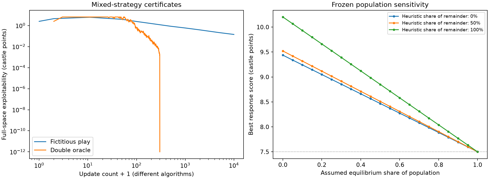

# Game 1 experiment results

## English

These are synthetic population experiments, not tournament scores. Game 1 only. All allocations list the 1-, 2-, 3-, 4-, 5-point castles in order. The original pasted results could not be reproduced without their exact model and code.

H denotes the heuristic population, C the concentrated population, and E the computed original-game equilibrium. Fixed scenario weights (H, C, E) are: heuristic_heavy (50%,25%,25%), balanced (25%,25%,50%), concentrated_heavy (10%,70%,20%), equilibrium_heavy (5%,15%,80%), equilibrium (0%,0%,100%). Endogenous scenarios fix 10% H, 25% H, or 25% C and let the remaining smart population jointly adapt. Model details: [opponents.md](../docs/modules/opponents.md). All scores are castle points, out of 15.

### Random baselines

| Model | Best response | Best score | All-in score |
| --- | --- | --- | --- |
| uniform_allocations | [0, 12, 23, 30, 35] | 9.884909 | 5.192307 |
| independent_soldiers | [0, 23, 25, 26, 26] | 12.576716 | 5.000000 |

### Pure-response cycles

| Initial strategy | Transient length | Cycle length |
| --- | --- | --- |
| all_in | 34 | 99 |
| one_step | 99 | 99 |
| equal | 47 | 99 |
| previous_candidate | 148 | 99 |

### Solver certificates

| Population | Iterations | Deviation gain | Smart score | Converged |
| --- | --- | --- | --- | --- |
| equilibrium | 300 | 4.62e-14 | 7.500000 | True |
| endogenous_10H | 284 | 1.46e-10 | 7.550473 | True |
| endogenous_25H | 251 | 8.88e-15 | 7.654613 | True |
| endogenous_25C | 352 | 1.51e-14 | 7.662327 | True |

Deviation gain is the best unilateral improvement against the complete modeled population. Only the equilibrium row is a minimax equilibrium of the original game.

### Exact optima by scenario

| Scenario | Best response | Score |
| --- | --- | --- |
| heuristic_heavy | [8, 2, 2, 36, 52] | 9.166187 |
| balanced | [8, 2, 2, 36, 52] | 8.510594 |
| concentrated_heavy | [1, 1, 1, 39, 58] | 9.014900 |
| equilibrium_heavy | [1, 1, 1, 39, 58] | 7.883125 |
| equilibrium | [8, 17, 6, 33, 36] | 7.500000 |
| endogenous_10H | [3, 26, 21, 19, 31] | 7.550473 |
| endogenous_25H | [9, 23, 31, 22, 15] | 7.654613 |
| endogenous_25C | [5, 14, 19, 13, 49] | 7.662327 |

### Holding the background fixed

| Population | Smart players frozen at E | Smart players adapted |
| --- | --- | --- |
| endogenous_10H | 7.770200 | 7.550473 |
| endogenous_25H | 8.175500 | 7.654613 |
| endogenous_25C | 7.984000 | 7.662327 |

### Fixed candidate comparison

| Candidate | Allocation | Balanced | Concentrated-heavy | Equilibrium-heavy | 25% H + adapted |
| --- | --- | --- | --- | --- | --- |
| equal | [20, 20, 20, 20, 20] | 6.804102 | 6.972491 | 6.955045 | 6.965244 |
| proportional | [7, 13, 20, 27, 33] | 7.351031 | 7.233187 | 7.435669 | 7.430548 |
| previous_baseline | [1, 1, 21, 31, 46] | 8.284062 | 8.263475 | 7.731787 | 7.654613 |
| previous_concentrated | [1, 1, 1, 41, 56] | 8.475406 | 9.001962 | 7.880381 | 7.654613 |
| previous_robust | [1, 14, 1, 37, 47] | 8.304781 | 8.504487 | 7.774719 | 7.654613 |
| new_balanced_best | [8, 2, 2, 36, 52] | 8.510594 | 8.756237 | 7.844119 | 7.654369 |
| new_minimax_regret | [1, 2, 2, 40, 55] | 8.503219 | 8.941237 | 7.873969 | 7.654613 |
| teammate | [2, 16, 1, 37, 44] | 8.119531 | 8.337462 | 7.722181 | 7.643976 |
| expanded_minimax_regret | [2, 2, 3, 39, 54] | 8.497219 | 8.864737 | 7.860419 | 7.654613 |
| rounded_equilibrium_mean | [6, 13, 20, 27, 34] | 7.428875 | 7.279175 | 7.453712 | 7.449518 |

Minimax regret: **[1, 2, 2, 40, 55]**; maximum regret **0.093063** points; **4,598,126** legal allocations examined.

This candidate is conditional on the eight declared scenarios. Read [the analysis](../docs/analysis.md) for reasoning and model limitations; inspect [summary.json](summary.json) for every score and sample-seed check. Solver certificates use floating-point arithmetic. The left plot clips errors below 1e-12; its horizontal axis counts updates, not runtime. The right plot varies the assumed equilibrium population share.

### Teammate comparison and broader proportion uncertainty

| Candidate | Allocation | Worst regret: original 8 | Worst regret: expanded 10 |
| --- | --- | --- | --- |
| teammate | [2, 16, 1, 37, 44] | 0.677438 | 1.206625 |
| new_minimax_regret | [1, 2, 2, 40, 55] | 0.093063 | 0.422375 |
| expanded_minimax_regret | [2, 2, 3, 39, 54] | 0.150163 | 0.327500 |

The expanded search adds pure H and pure C to the original eight scenarios. It checks all 4,598,126 legal allocations and selects [2, 2, 3, 39, 54]. This covers every fixed H/C/E proportion through the endpoint regret bound. It also retains the three previously solved adapted populations, but does not recompute S at every new background proportion. H/C generation rules and weights within each model are unchanged.

## 中文

以下是本项目自建人群的实验，并非官方成绩。只研究第一局。配兵按1、2、3、4、5分城排列。旧分析缺少完整代码和模型参数，因此这里是重新建模，不能称为复现旧数值。

H 表示直觉型人群，C 表示集中型人群，E 表示计算得到的原博弈均衡。固定情景的 (H,C,E) 比例分别是：heuristic_heavy (50%,25%,25%)、balanced (25%,25%,50%)、concentrated_heavy (10%,70%,20%)、equilibrium_heavy (5%,15%,80%)、equilibrium (0%,0%,100%)。三个 endogenous 情景分别固定10% H、25% H、25% C，让其余聪明人群共同适应。生成细节见 [opponents.md](../docs/modules/opponents.md)。所有得分均为城堡分，满分15。

### 随机基准

| 随机模型 | 最佳回应 | 最优分数 | 全押第五城得分 |
| --- | --- | --- | --- |
| uniform_allocations | [0, 12, 23, 30, 35] | 9.884909 | 5.192307 |
| independent_soldiers | [0, 23, 25, 26, 26] | 12.576716 | 5.000000 |

### 纯策略反制循环

| 起始策略 | 过渡长度 | 循环长度 |
| --- | --- | --- |
| all_in | 34 | 99 |
| one_step | 99 | 99 |
| equal | 47 | 99 |
| previous_candidate | 148 | 99 |

### 求解误差证书

| 人群 | LP轮数 | 偏离可增分 | 聪明人群均分 | 达到容限 |
| --- | --- | --- | --- | --- |
| equilibrium | 300 | 4.62e-14 | 7.500000 | True |
| endogenous_10H | 284 | 1.46e-10 | 7.550473 | True |
| endogenous_25H | 251 | 8.88e-15 | 7.654613 | True |
| endogenous_25C | 352 | 1.51e-14 | 7.662327 | True |

偏离可增分是聪明子群体面对整个模型人群时，单方改用最佳回应还能提高的分数。只有 equilibrium 行求的是原博弈的 minimax 均衡；有背景人群的行求的是子群体的适应均衡。

### 各情景的精确最佳回应

| 情景 | 最佳回应 | 分数 |
| --- | --- | --- |
| heuristic_heavy | [8, 2, 2, 36, 52] | 9.166187 |
| balanced | [8, 2, 2, 36, 52] | 8.510594 |
| concentrated_heavy | [1, 1, 1, 39, 58] | 9.014900 |
| equilibrium_heavy | [1, 1, 1, 39, 58] | 7.883125 |
| equilibrium | [8, 17, 6, 33, 36] | 7.500000 |
| endogenous_10H | [3, 26, 21, 19, 31] | 7.550473 |
| endogenous_25H | [9, 23, 31, 22, 15] | 7.654613 |
| endogenous_25C | [5, 14, 19, 13, 49] | 7.662327 |

### 保持背景人群及其比例不变

| 人群 | 聪明人固定使用E时的最优分数 | 聪明人共同适应后的最优分数 |
| --- | --- | --- |
| endogenous_10H | 7.770200 | 7.550473 |
| endogenous_25H | 8.175500 | 7.654613 |
| endogenous_25C | 7.984000 | 7.662327 |

### 固定候选方案比较

| 候选 | 配兵 | 基准 | 集中型较多 | 均衡型较多 | 25% H＋适应者 |
| --- | --- | --- | --- | --- | --- |
| equal | [20, 20, 20, 20, 20] | 6.804102 | 6.972491 | 6.955045 | 6.965244 |
| proportional | [7, 13, 20, 27, 33] | 7.351031 | 7.233187 | 7.435669 | 7.430548 |
| previous_baseline | [1, 1, 21, 31, 46] | 8.284062 | 8.263475 | 7.731787 | 7.654613 |
| previous_concentrated | [1, 1, 1, 41, 56] | 8.475406 | 9.001962 | 7.880381 | 7.654613 |
| previous_robust | [1, 14, 1, 37, 47] | 8.304781 | 8.504487 | 7.774719 | 7.654613 |
| new_balanced_best | [8, 2, 2, 36, 52] | 8.510594 | 8.756237 | 7.844119 | 7.654369 |
| new_minimax_regret | [1, 2, 2, 40, 55] | 8.503219 | 8.941237 | 7.873969 | 7.654613 |
| teammate | [2, 16, 1, 37, 44] | 8.119531 | 8.337462 | 7.722181 | 7.643976 |
| expanded_minimax_regret | [2, 2, 3, 39, 54] | 8.497219 | 8.864737 | 7.860419 | 7.654613 |
| rounded_equilibrium_mean | [6, 13, 20, 27, 34] | 7.428875 | 7.279175 | 7.453712 | 7.449518 |

Minimax regret 配兵：**[1, 2, 2, 40, 55]**；最大落后 **0.093063** 分；已枚举 **4,598,126** 个合法向量。

这个候选只对明确列出的八种情景成立。推导和下一步实验见[中文分析](../docs/analysis.md)；完整得分与换种子检查见 [summary.json](summary.json)。求解误差来自浮点计算。左图将低于1e-12的误差按1e-12显示，横轴是更新次数而非运行时间；右图改变假定的均衡型人群比例。

### 队友方案与更广的人群比例范围

| 候选 | 配兵 | 原8情景最大regret | 扩展10情景最大regret |
| --- | --- | --- | --- |
| teammate | [2, 16, 1, 37, 44] | 0.677438 | 1.206625 |
| new_minimax_regret | [1, 2, 2, 40, 55] | 0.093063 | 0.422375 |
| expanded_minimax_regret | [2, 2, 3, 39, 54] | 0.150163 | 0.327500 |

扩展搜索在原八种情景上加入纯H、纯C，枚举全部4,598,126个合法配兵，得到[2, 2, 3, 39, 54]。端点regret界覆盖H/C/E分布固定时的任意人群比例，也保留三种已有适应人群；没有为每个新背景比例重新计算S。H/C内部生成规则未改变。

